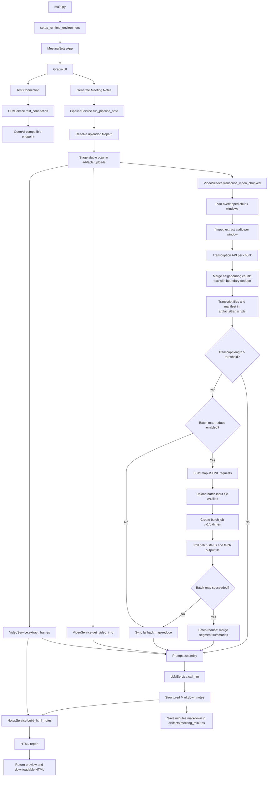

# Meeting Notes Helper

Meeting Notes Helper is a local Gradio app that turns a meeting recording or a user-provided transcript into structured notes and an HTML report.

The app workflow is:

1. Upload a meeting video(a pre-recorded video file) or upload a transcript file(a text file, transcribed from audio by Teams or other tools).
2. If video is provided, extract screenshots from key points in the recording.
3. If video is provided, transcribe the recording in overlap-aware chunks (with neighbouring context).
4. Merge adjacent chunk transcripts with boundary deduplication, then for long transcripts run map-reduce summarization to build a condensed digest.
5. Send transcript evidence (full/digest + screenshot context when available) to any OpenAI-compatible model (OpenAI, OpenRouter, Groq, DeepSeek, Gemini, Ollama, LM Studio, vLLM, LiteLLM, ...).
6. Generate Markdown meeting notes, an HTML preview, and saved artifacts under `artifacts/`.

**Note**
Uploads are de-duplicated by content: if you upload a recording that was already
processed (even under a different filename), the app detects it and shows a
notice pointing to the existing notes. The file is kept and is not copied to
`artifacts/` again, but you can still (re)generate notes from it as many times
as you like.

## Overall Workflow Design



### Component Responsibilities

- `main.py` starts the app and launches the Gradio UI.
- `meeting_notes/bootstrap.py` applies runtime setup, loads `.env`, and prepares default provider settings.
- `meeting_notes/ui.py` builds the Gradio interface and wires buttons to service methods.
- `meeting_notes/pipeline.py` orchestrates the end-to-end workflow and handles user-facing errors.
- `meeting_notes/video.py` reads video metadata, extracts screenshots, plans overlap-aware audio windows with ffmpeg extraction, transcribes chunks, and deduplicates neighbouring chunk boundaries.
- `meeting_notes/llm.py` wraps OpenAI-compatible chat, batch, and transcription client calls plus optional extra headers.
- `meeting_notes/notes.py` converts generated Markdown into the final HTML report with embedded screenshots.

### Runtime Data Flow

1. The user uploads a recording through the Gradio `File` component. On upload, the app hashes the file (SHA-256) and checks it against the upload index; if the same content was processed before, it shows a duplicate notice but keeps the file so notes can still be generated.
2. The pipeline copies the uploaded temp file into `artifacts/uploads/` so the rest of the run uses a stable local path (duplicate content reuses the existing copy instead of writing a second one). The content hash is recorded in `artifacts/uploads/.upload_index.json` so future duplicates are detected by bytes, not filename.
3. The video service reads metadata and samples screenshots at the requested interval.
4. The same service plans overlap-aware audio windows, extracts each window, and sends each chunk to the transcription endpoint.
5. Adjacent chunk transcripts are merged with boundary deduplication to reduce repeated overlap text.
6. The transcript, plain-text transcript, chunk files, and manifest are written under `artifacts/transcripts/`.
7. If transcript length exceeds the configured threshold, the pipeline applies map-reduce over transcript segments (segment summaries, then merged digest) before final note generation.
8. The pipeline builds a prompt from transcript evidence (raw transcript or condensed digest), screenshot timestamps, selected note style, and output language.
9. The chat completion call generates Markdown meeting notes with screenshot placeholders.
10. The notes service replaces placeholders with embedded images, renders the HTML report, and saves Markdown minutes.
11. The UI returns screenshots, Markdown, HTML preview, and a downloadable HTML artifact.

## Why This App Over Built-in Meeting Transcription
1. Many meeting tools can transcribe audio but discard the visual context, or recording is disabled by policy.
2. This app works from a local meeting recording file, which makes it useful when you need to process recordings captured outside your meeting tool's standard recording flow.
3. Built-in transcription gives you spoken text, but this app also extracts screenshots from the recording so the notes can reference what was shown on screen.
4. Visual context matters in technical and project meetings because decisions are often made from slides, demos, dashboards, diagrams, or shared documents that are not captured by transcript text alone.
5. The app turns raw transcript content into structured meeting minutes instead of leaving you with a long conversational transcript to clean up manually.
6. Generated notes can be tailored by output style and language, which helps produce minutes that match the audience and purpose of the meeting.
7. The workflow saves reusable artifacts such as transcripts, chunk files, screenshots, Markdown minutes, and an HTML report for later review and traceability.
8. The HTML report makes it easier to review and share outcomes because screenshots are placed alongside the generated notes.
9. Running the workflow locally gives you more control over the input files, generated artifacts, and the choice of LLM provider.

## What You Need

- Python 3.11+
- An OpenAI-compatible endpoint (cloud provider, local Ollama/LM Studio, or a self-hosted proxy)
- An API key for that endpoint (local servers usually accept any value)
- A meeting recording file supported by your local video stack

Install dependencies:

```bash
pip install -e .
```

## Configure The App

The UI can be filled in manually, but the app also loads defaults from a local `.env` file.

Supported environment variables, create a `.env` file in root directory and copy from `.env.example` :

```env
LLM_BASE_URL=https://api.openai.com/v1
LLM_API_KEY=sk-your-key
LLM_MODEL=gpt-4o-mini
# LLM_EXTRA_HEADERS={"HTTP-Referer": "https://example.com", "X-Title": "Meeting Notes"}
LLM_TRANSCRIBE_MODEL=gpt-4o-transcribe
# LLM_TRANSCRIBE_BASE_URL=https://api.groq.com/openai/v1
# LLM_TRANSCRIBE_API_KEY=gsk-your-key
# LLM_OCR_MODEL=gpt-4o-mini
LLM_MAX_CHAT_REQUEST_BYTES=10485760
LLM_DIRECT_TRANSCRIPT_CHAR_LIMIT=30000
LLM_NOTES_MAP_REDUCE_TRIGGER_CHARS=28000
LLM_NOTES_MAP_REDUCE_SEGMENT_CHARS=12000
LLM_NOTES_USE_BATCH_MAP_REDUCE=false
# Leave stage budgets unset to get model-aware defaults (larger for reasoning models)
# LLM_NOTES_SEGMENT_MAX_TOKENS=4000
# LLM_NOTES_REDUCE_MAX_TOKENS=3500
# LLM_NOTES_FINAL_MAX_TOKENS=8000
LLM_NOTES_LENGTH_RETRY_ENABLED=true
LLM_NOTES_LENGTH_RETRY_TOKEN_MULTIPLIER=1.5
LLM_NOTES_LENGTH_RETRY_MAX_TOKENS=32000
LLM_NOTES_FALLBACK_MODEL=gpt-4o
LLM_NOTES_FALLBACK_MAX_TOKENS=16000
# LLM_REASONING_MODEL_PREFIXES=kimi,o1,o3,o4,deepseek-r1,deepseek-reasoner
# LLM_REQUEST_TIMEOUT_SECONDS=300
# LLM_REASONING_CONTROL_EXTRA_BODY={"thinking": {"type": "disabled"}}
# LLM_REASONING_EFFORT=low
LLM_BATCH_JSONL_SOFT_LIMIT_BYTES=157286400
LLM_BATCH_POLL_INTERVAL_SECONDS=5
LLM_BATCH_MAX_WAIT_SECONDS=300
LLM_BATCH_COMPLETION_WINDOW=24h
```

Notes:

- `LLM_BASE_URL` falls back to `OPENAI_BASE_URL`, then `https://api.openai.com/v1`
- `LLM_API_KEY` falls back to `OPENAI_API_KEY`
- `LLM_MODEL` defaults to `gpt-4o-mini`
- `LLM_EXTRA_HEADERS` (optional JSON object) adds provider-specific HTTP headers to every request (chat, batch, and transcription)
- `LLM_TRANSCRIBE_MODEL` defaults to `gpt-4o-transcribe`. `LLM_TRANSCRIBE_BASE_URL` / `LLM_TRANSCRIBE_API_KEY` let you send audio to a different provider than chat (they fall back to the main values)
- `LLM_OCR_MODEL` is disabled by default; set to a vision model name in `.env` if you want to enable OCR frame keyword extraction
- `LLM_MAX_CHAT_REQUEST_BYTES` defaults to `10485760` and is used to recommend screenshot settings that stay below your provider's request-size limit
- `LLM_DIRECT_TRANSCRIPT_CHAR_LIMIT` defaults to `30000` for direct (non-map-reduce) transcript prompt clipping
- `LLM_NOTES_MAP_REDUCE_TRIGGER_CHARS` defaults to `28000`; transcripts above this use map-reduce summarization
- `LLM_NOTES_MAP_REDUCE_SEGMENT_CHARS` defaults to `12000`; controls segment size during map pass
- `LLM_NOTES_USE_BATCH_MAP_REDUCE` defaults to `false`; set `true` to run transcript map-reduce via `/v1/files` + `/v1/batches` (only if your provider supports the OpenAI Batch API)
- `LLM_NOTES_SEGMENT_MAX_TOKENS`, `LLM_NOTES_REDUCE_MAX_TOKENS`, and `LLM_NOTES_FINAL_MAX_TOKENS` independently control output budgets for each notes stage. When unset, reasoning models (see `LLM_REASONING_MODEL_PREFIXES`) get larger defaults (16000/16000/24000) because hidden thinking consumes part of `max_tokens`
- `LLM_NOTES_LENGTH_RETRY_ENABLED` defaults to `true`; only empty responses ending with `finish_reason="length"` are retried
- `LLM_NOTES_LENGTH_RETRY_TOKEN_MULTIPLIER` defaults to `1.5`; the retry happens exactly once with the enlarged stage budget, capped by `LLM_NOTES_LENGTH_RETRY_MAX_TOKENS` (default `32000`)
- `LLM_NOTES_FALLBACK_MODEL` defaults to `gpt-4o`; used once when the primary model still produces no visible output after the retry (set empty to disable, or to a model your provider serves). For map segments, the segment is first split in half; if every attempt fails the raw segment text is passed to the merge step so one segment cannot abort the run. Any recovery is listed in the notes' Artifacts section
- `LLM_REQUEST_TIMEOUT_SECONDS` overrides the per-call HTTP timeout (default 120s, 300s for reasoning models)
- `LLM_REASONING_EFFORT` (`none` | `minimal` | `low` | `medium` | `high`, default `none`) sets the initial value of the **Reasoning effort** dropdown in the UI (also used by MCP calls that omit `reasoning_effort`). Any value other than `none` sends `{"reasoning": {"effort": "<value>"}}` to **every** model; if a model rejects it (HTTP 400/422), the request is silently resent without it and that model/effort pair is skipped for the rest of the process. `none` sends no reasoning setting at all and also suppresses `LLM_REASONING_CONTROL_EXTRA_BODY`
- `LLM_REASONING_CONTROL_EXTRA_BODY` (optional JSON) is the legacy fallback, used only when no reasoning effort is specified by the caller (e.g. scripts/MCP without `reasoning_effort` and no `LLM_REASONING_EFFORT`). It is sent only to reasoning models, e.g. `{"thinking": {"type": "disabled"}}` for Kimi K2.x. If the model rejects it (always-thinking models such as Kimi K3), it is dropped for that model for the rest of the process
- `LLM_BATCH_JSONL_SOFT_LIMIT_BYTES` defaults to `157286400` (150 MB) and should remain well below the 200 MB upload hard limit
- `LLM_BATCH_POLL_INTERVAL_SECONDS` defaults to `5`; controls batch status polling interval
- `LLM_BATCH_MAX_WAIT_SECONDS` defaults to `300`; when exceeded, map-reduce falls back to synchronous calls
- `LLM_BATCH_COMPLETION_WINDOW` defaults to `24h`; passed to batch creation
- **Do not expose your API keys**, keep them inside your `.env` file locally

## Provider Compatibility

Any endpoint that implements the OpenAI `/chat/completions` API works for note generation. Other features depend on what the provider offers:

| Provider | Base URL | Chat | Vision (screenshots/OCR) | `/audio/transcriptions` | Batch API |
|---|---|---|---|---|---|
| OpenAI | `https://api.openai.com/v1` | yes | yes | yes | yes |
| Azure OpenAI (v1 API) | `https://<resource>.openai.azure.com/openai/v1` | yes | yes | yes | yes |
| OpenRouter | `https://openrouter.ai/api/v1` | yes | model-dependent | no | no |
| Groq | `https://api.groq.com/openai/v1` | yes | model-dependent | yes (Whisper) | yes |
| Google Gemini | `https://generativelanguage.googleapis.com/v1beta/openai` | yes | yes | no | no |
| DeepSeek | `https://api.deepseek.com/v1` | yes | no | no | no |
| Ollama (local) | `http://localhost:11434/v1` | yes | model-dependent | no | no |
| LM Studio / vLLM | `http://localhost:1234/v1` / `http://localhost:8000/v1` | yes | model-dependent | vLLM only | no |

Tips:

- If your chat provider has no transcription endpoint, set `LLM_TRANSCRIBE_BASE_URL` / `LLM_TRANSCRIBE_API_KEY` to one that does (e.g. OpenAI or Groq), or upload a transcript file instead of a video.
- Text-only models still work: when a provider rejects images, the app automatically retries with a text-only prompt that keeps screenshot timestamps.
- Keep `LLM_NOTES_USE_BATCH_MAP_REDUCE=false` unless your provider supports the Batch API; the synchronous path works everywhere.
- Capabilities change over time, so check your provider's docs.

## Batch Request Flow (Transcript Map-Reduce)

This flow is used only when both conditions are true:

- `LLM_NOTES_USE_BATCH_MAP_REDUCE=true`
- transcript length is above `LLM_NOTES_MAP_REDUCE_TRIGGER_CHARS`

The final meeting-notes generation call stays synchronous. Batch mode is used only for transcript map-reduce.

1. Split transcript into map-reduce segments using `LLM_NOTES_MAP_REDUCE_SEGMENT_CHARS`.
2. Build one JSONL request line per segment (`/v1/chat/completions`) with a stable `custom_id`.
3. Check JSONL size before upload:
   - hard stop at 200 MB provider limit
   - safety stop at `LLM_BATCH_JSONL_SOFT_LIMIT_BYTES` (default 150 MB)
4. Upload JSONL to the Files API (`POST /v1/files`, `purpose=batch`).
5. Create batch job (`POST /v1/batches`) with `endpoint=/v1/chat/completions` and `completion_window=LLM_BATCH_COMPLETION_WINDOW`.
6. Poll batch status every `LLM_BATCH_POLL_INTERVAL_SECONDS` until completion or `LLM_BATCH_MAX_WAIT_SECONDS`.
7. Download output file (`/v1/files/{output_file_id}/content`) and parse JSONL results.
8. Match each result back to its input using `custom_id`, preserving original segment order.
9. Run reduce step from map summaries (batch mode first, then sync fallback if needed).
10. Continue normal synchronous notes generation using the reduced digest as transcript evidence.

Fallback behavior:

- If batch map step fails, the app automatically retries map step with synchronous calls.
- If batch reduce step fails, the app automatically retries reduce step with synchronous calls.
- If both batch and sync fail for the same stage, generation fails with an explicit error.

## Start The App

Run:

```bash
python main.py
```

The Gradio UI starts locally on the first available port from `7860` to `7870`, usually `http://127.0.0.1:7860`.

## How To Use It

### 1. Open The Web UI

When the app launches, you will see fields for your LLM provider settings on top and the meeting-notes workflow underneath.

### 2. Confirm Your Model Connection

In the `LLM Provider Settings` section:

- Enter or verify the base URL
- Enter the API key
- Choose the model name
- Click `Test Connection`

If you supplied values through `.env`, the UI preloads them and shows where each default came from.

### 3. Upload A Recording Or Transcript

Use `Video Recording` to upload the meeting file you want to process.
Or use `Transcript File (optional, skips video processing)` to upload a transcript directly.

If the file was already uploaded before (matched by content, regardless of its
name), the app shows a duplicate notice that points to the existing notes. The
file is kept and is not copied to `artifacts/` again, and you can still generate
notes from it.

Then adjust the generation options:

- `Screenshot interval (seconds)`: how often frames are sampled
- `Max screenshots`: hard limit for extracted screenshots
- `Notes style`: the tone and structure of the output
- `Output language`: the language used in the generated notes

Transcript-only mode behavior:

- If you upload only a transcript file, the app skips video staging, frame extraction, OCR, and audio transcription.
- The transcript is sent directly to the notes-generation prompt.
- Screenshot settings are ignored in this mode because no frames are processed.
- Artifacts still include generated meeting minutes and HTML output.

After a video is selected, the app recommends a screenshot interval and maximum
screenshot count based on the recording length and estimated screenshot payload.
The recommendation is sized to keep the final notes-generation request under
the configured request-size budget while preserving visual context for long meetings.

### 4. Generate Meeting Notes

Click `Generate Meeting Notes`.

The app will:

- For video input:
	- copy the uploaded file into `artifacts/uploads/`
	- extract screenshots from the video
	- transcribe the recording in overlap-aware chunks
	- merge neighbouring chunk text with boundary deduplication
	- if transcript is long, summarize chunks using map-reduce before final notes generation
	- generate Markdown notes from transcript + screenshot context
	- build an HTML report with screenshot placement
- For transcript-only input:
	- read the uploaded transcript file directly
	- skip video, screenshot, OCR, and transcription processing
	- if transcript is long, summarize segments using map-reduce before final notes generation
	- generate Markdown notes from transcript content
	- build an HTML report without screenshot sections

The main results appear in the UI as:

- `Captured Screenshots`
- `Markdown Notes`
- `HTML Preview`
- `Download`

### 5. Review The HTML Report

The generated HTML output is designed for quick review and sharing.

### 6. Find The Saved Artifacts

After a successful run, the app saves outputs to `artifacts/`:

- `artifacts/uploads/`: a stable copy of the uploaded video
- `artifacts/uploads/.upload_index.json`: content-hash index used to detect duplicate uploads
- `artifacts/transcripts/`: transcript text, plain-text transcript, chunk files, and manifest JSON
- `artifacts/meeting_minutes/`: generated Markdown minutes
- the downloadable HTML file is also produced for the UI download tab

Transcript-only run notes:

- `artifacts/uploads/` is not used unless a video was uploaded.
- No screenshot images are written for transcript-only runs.
- The transcript artifact points to your uploaded transcript path.

## Output Summary

Each run produces:

- Markdown meeting minutes
- An HTML meeting-notes report
- Captured screenshots from the video (video input only)
- Transcript files and manifest metadata (video input), or your uploaded transcript reference (transcript-only input)

## MCP Server

The project also ships as an MCP (Model Context Protocol) server, allowing any
MCP-compatible client — Claude Desktop, VS Code Copilot Chat, Cursor, or custom
agents — to drive the meeting-notes workflow programmatically.

### Available Tools

| Tool | Description |
|------|-------------|
| `test_llm_connection` | Verify the LLM provider is reachable |
| `generate_meeting_notes` | Generate notes from a video or transcript file |
| `list_meeting_minutes` | List all saved minutes files |
| `get_meeting_minutes` | Read a specific minutes file |
| `get_latest_meeting_minutes` | Read the most recent minutes file |
| `list_note_styles` | Show available note-generation styles |
| `get_video_info` | Get metadata for a local video file |

### Available Resources

| URI | Description |
|-----|-------------|
| `meeting-notes://minutes/latest` | Latest meeting-minutes markdown |
| `meeting-notes://minutes/list` | JSON list of all minutes files |
| `meeting-notes://config/status` | Current .env configuration status |

### Run the MCP Server

You can self-host a MCP server by:

```bash
# stdio transport (default — used by Claude Desktop, VS Code, etc.)
python mcp_server.py

# SSE transport on http://localhost:8000/sse
python mcp_server.py --sse
```

### Configure Your MCP Client

Copy the snippet from `mcp-config.json` into your client's MCP settings.
Adjust the `--directory` path to match your local checkout.
Once configured, you can access features in this app wrapped by MCP via AI chat.

**MCP configuration on MCP-capable client**

Such as:
- Claude Desktop (`claude_desktop_config.json`)
- VS Code (`.vscode/mcp.json` or User Settings)

```json
{
  "mcpServers": {
    "meeting-notes-helper": {
      "command": "uv",
      "args": [
        "run",
        "--directory",
        "/path/to/meeting-notes-helper",
        "python",
        "mcp_server.py"
      ]
    }
  }
}
```

All LLM connection parameters (`base_url`, `api_key`, `model`, etc.) are
optional in every tool — they fall back to `.env` / environment defaults
when omitted, just like the Gradio UI.

## Troubleshooting

- If generation fails on Windows right after upload, re-upload the video and try again. The app already stages uploads into `artifacts/uploads/` to reduce temporary-file locking issues.
- If the UI does not open on `7860`, check the next ports up to `7870`.
- If connection testing fails, verify the base URL (it usually ends in `/v1`), model name, and API key.
- If transcription fails with a 404, your provider has no `/audio/transcriptions` endpoint; set `LLM_TRANSCRIBE_BASE_URL` / `LLM_TRANSCRIBE_API_KEY` to one that does, or upload a transcript file instead.
- If a recording is wrongly reported as a duplicate, it matches the content of a previously processed file. To clear that association, remove its entry from `artifacts/uploads/.upload_index.json` (or delete that file to reset all tracking; it is rebuilt from existing uploads on the next upload).
- If you are still struggling, load the repository in VS Code and paste the errors you encounter into GitHub Copilot chat.
