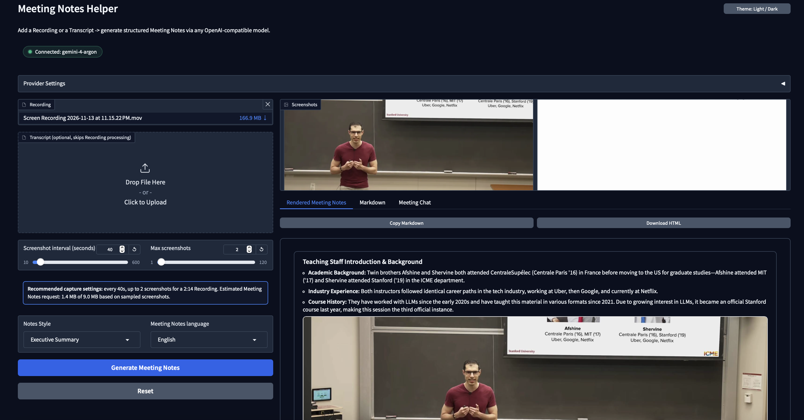
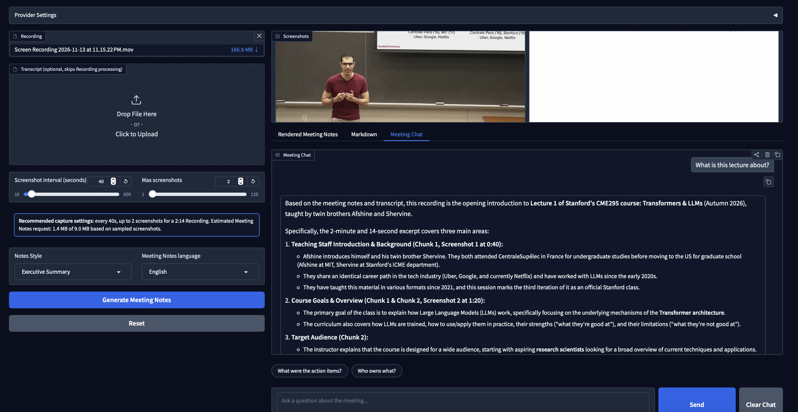

# Meeting Notes Helper

[](https://github.com/SophiaSama/meeting-notes-generator/actions/workflows/ci.yml)
[](https://www.python.org/downloads/)
[](LICENSE)
[](docker-compose.yml)
[](mcp_server.py)

**Meeting Notes Helper** is a multimodal meeting intelligence tool and local Gradio application that transforms meeting Recordings or Transcripts into structured Meeting Notes (rendered HTML, Markdown, and downloadable export) and enables grounded **Meeting Chat** using any OpenAI-compatible Provider and native Google Gemini or OpenAI-compatible audio transcription.

It also provides a first-class **Model Context Protocol (MCP)** server, enabling AI assistants such as Claude Desktop, VS Code Copilot, and Cursor to execute the entire meeting analysis pipeline programmatically.

---

## Key Features

- **Multimodal Recording & Transcript Input**: Process Recording files (`.mp4`, `.mkv`, `.webm`, etc.) with automatic Screenshot and audio extraction, or supply pre-existing Transcripts (`.txt`, `.md`, `.rtf`) to skip Recording processing.
- **Native Gemini & OpenAI-Compatible Audio Transcription**: Supports native Google GenAI audio transcription (`gemini-3.5-transcribe` via `google-genai` with speaker diarization and timestamps) alongside OpenAI-compatible `/audio/transcriptions` endpoints (e.g. OpenAI, Groq Whisper), with upfront configuration and audio-track validation.
- **Grounded Meeting Chat**: Ask multi-turn follow-up questions in the **Meeting Chat** tab after generating Meeting Notes. Answers are grounded in the generated Meeting Notes, full or condensed Transcript evidence, and per-Screenshot OCR + timestamp metadata, with session isolation, dynamic model/reasoning-effort switching between turns, and one-click chat reset.
- **Visual Context & Screenshot Sampling**: Samples high-value presentation Screenshots from Recordings, performs concurrent OCR text extraction, and embeds Screenshots alongside relevant discussion sections in the rendered Meeting Notes.
- **Parallel Visual & Audio Extraction**: Executes Screenshot extraction (+ OCR) and audio chunk transcription concurrently, with multi-threaded chunk slicing/transcription (`LLM_TRANSCRIBE_MAX_WORKERS`) and Screenshot OCR (`LLM_OCR_MAX_WORKERS`).
- **Overlap-Aware Audio Chunking**: Splits long audio recordings into overlapping segments with boundary deduplication, eliminating cutoff sentences at chunk edges.
- **Scalable Map-Reduce Summarization**: Long transcripts exceeding token thresholds are summarized through a map-reduce pipeline (segment summaries merged into a cohesive digest), supporting both synchronous calls and the asynchronous OpenAI Batch API (`/v1/files` + `/v1/batches`).
- **Deep Reasoning Model Support**: Built-in support for reasoning models (e.g. OpenAI o1/o3, Moonshot Kimi, DeepSeek-R1) with customizable reasoning effort (`none`, `minimal`, `low`, `medium`, `high`), chain-of-thought stripping, automatic empty-response token-budget retries (`finish_reason="length"`), and fallback model support.
- **Content-Based Duplicate Detection**: Uses SHA-256 byte hashing to detect duplicate uploads regardless of file renaming, preventing redundant disk consumption while allowing instant regeneration.
- **Tailored Notes Styles**: Output in multiple structured Notes Styles (Executive Summary, Detailed Notes, Action Items Focus, Technical Minutes) and languages.
- **Interactive Meeting Chat**: Question-and-answer conversation grounded in the active meeting's Meeting Notes and Transcript, featuring starter question chips ("What were the action items?", "Who owns what?").
- **Model Context Protocol (MCP)**: Native FastMCP implementation offering stdio and SSE transports for tool calling and artifact resource inspection.
- **Docker & GitHub Actions CI**: Production-ready container images with non-root security and multi-stage `uv` caching for both Web UI and MCP services, backed by automated GitHub Actions CI for `pytest` and Docker builds.

---

## Overall Workflow Design

```mermaid
flowchart TD
 A[main.py] --> B[setup_runtime_environment]
 B --> C[MeetingNotesApp]
 C --> D[Gradio UI]

 D --> E[Test Connection]
 E --> F[LLMService.test_connection]
 F --> G[OpenAI-compatible endpoint]

 D --> H[Generate Meeting Notes]
 H --> I[PipelineService.run_pipeline_safe]
 I --> J[Resolve uploaded filepath & validate transcription config]
 J --> K[Stage stable copy in artifacts/uploads]
 K --> L[VideoService.get_video_info]
 L --> P_SPLIT{Parallel Visual & Audio Branches}
 P_SPLIT -->|Visual Worker| M[VideoService.extract_frames]
 M --> M_OCR[Concurrent Frame OCR]
 P_SPLIT -->|Audio Worker| N[VideoService.transcribe_video_chunked]

 N --> O[Plan overlapped chunk windows & verify audio track]
 O --> P_BACKEND{Transcribe Model Type?}
 P_BACKEND -->|gemini-*| P_GEM["Concurrent ffmpeg slice + Google GenAI Files & Interactions API (diarization + timestamps)"]
 P_BACKEND -->|OpenAI-compatible| P_OAI["Concurrent ffmpeg slice + OpenAI /audio/transcriptions"]
 P_GEM --> QX[Merge neighbouring chunk text with boundary dedupe]
 P_OAI --> QX
 QX --> QY[Transcript files and manifest in artifacts/transcripts]
 QY --> QA{Transcript length > threshold?}
 QA -->|No| R
 QA -->|Yes| QB{Batch map-reduce enabled?}
 QB -->|Yes| QC[Build map JSONL requests]
 QC --> QD[Upload batch input file /v1/files]
 QD --> QE[Create batch job /v1/batches]
 QE --> QF[Poll batch status and fetch output file]
 QF --> QG{Batch map succeeded?}
 QG -->|Yes| QH[Batch reduce: merge segment summaries]
 QG -->|No| QI[Sync fallback map-reduce]
 QB -->|No| QI
 QH --> R
 QI --> R

<<<<<<< HEAD
 M_OCR --> R[Prompt assembly]
 R --> S[LLMService.call_llm]
 S --> T[Structured Markdown notes]

 T --> U[NotesService.build_html_notes]
 M --> U
 U --> V[HTML report]

 T --> W[Save minutes markdown in artifacts/meeting_minutes]
 V --> X[Return preview and downloadable HTML]
 T --> CTX["Build session MeetingContext (gr.State)"]
 M_OCR --> CTX
 QY --> CTX

 CTX --> CHAT[Chat with Meeting Tab]
 D --> CHAT
 CHAT --> QA_CALL[PipelineService.query_meeting_safe]
 QA_CALL --> QA_LLM[Grounded multi-turn LLM Q&A with length-retry & CoT stripping]
 QA_LLM --> CHAT
=======
	M_OCR --> R[Prompt assembly]
	R --> S[LLMService.call_llm]
	S --> T[Structured Markdown Meeting Notes]

	T --> U[NotesService.build_html_notes]
	M --> U
	U --> V[Rendered Meeting Notes]

	T --> W[Save Meeting Notes markdown in artifacts/meeting_minutes]
	V --> X[Rendered Meeting Notes, Markdown, and Download HTML]
	T --> CTX["Build session MeetingContext (gr.State)"]
	M_OCR --> CTX
	QY --> CTX

	CTX --> CHAT[Meeting Chat Tab]
	D --> CHAT
	CHAT --> QA_CALL[PipelineService.query_meeting_safe]
	QA_CALL --> QA_LLM[Grounded multi-turn LLM Q&A with length-retry & CoT stripping]
	QA_LLM --> CHAT
>>>>>>> b8503e1 (feat: polish full-width responsive UI, ResultsPaneState, and docs)
```

### Component Responsibilities

| Component | Responsibility |
| --- | --- |
| `main.py` | Application entrypoint; bootstraps runtime and launches the Gradio UI. |
| `mcp_server.py` | FastMCP server exposing tools and resources over stdio or SSE. |
| `meeting_notes/bootstrap.py` | Environment setup, `.env` parsing, telemetry suppression, and proxy configuration. |
| `meeting_notes/views.py` | Pure presentation view helpers and `ResultsPaneState` state transitions (Provider chip, empty state, stage progress, error banners, and starter questions). |
| `meeting_notes/ui.py` | Gradio interface layout, theme configuration, Provider status chip, stage progress tracking, session-isolated `gr.State` management, and **Meeting Chat**. |
| `meeting_notes/pipeline.py` | End-to-end orchestration, parallel visual/audio branch execution, upload deduplication, `MeetingContext` construction, grounded multi-turn Q&A (`query_meeting` / `query_meeting_safe`), token budgeting, and fallback management. |
| `meeting_notes/video.py` | Video metadata probing, Screenshot sampling, concurrent `ffmpeg` audio windowing, native Google Gemini (`google-genai`) and OpenAI-compatible transcription routing, audio-track detection, and boundary text deduplication. |
| `meeting_notes/llm.py` | Unified client wrapper for OpenAI-compatible chat, vision, batch, and transcription endpoints with reasoning control. |
| `meeting_notes/notes.py` | Markdown parsing, Screenshot embedding, template rendering, and HTML Meeting Notes generation. |

---

## Project Structure

```text
meeting-notes-generator/
├── .github/
│   └── workflows/
│       └── ci.yml              # GitHub Actions CI (pytest + Docker build & compose check)
├── artifacts/                  # Generated runtime artifacts (git-ignored)
│   ├── meeting_minutes/        # Markdown Meeting Notes (*.minutes.md)
│   ├── transcripts/            # Chunk transcripts, full text, and manifests
│   └── uploads/                # Staged uploads and .upload_index.json
├── docs/                       # Technical documentation and ADRs
│   └── kimi-reasoning-response-handling.md
├── meeting_notes/              # Core application package
│   ├── __init__.py
│   ├── bootstrap.py            # Runtime configuration and environment loading
│   ├── llm.py                  # LLM, Batch, and Audio client service
│   ├── notes.py                # Markdown to HTML Meeting Notes generator
│   ├── pipeline.py             # Main processing pipeline & Meeting Chat service
│   ├── ui.py                   # Gradio Web UI definition & Meeting Chat wiring
│   ├── video.py                # Video extraction, Gemini/OpenAI audio transcription
│   └── views.py                # Pure presentation view helpers & ResultsPaneState
├── specs/                      # Feature specifications
│   ├── meeting-qa-chatbot.md   # Meeting Q&A Chatbot specification
│   └── polished-ui.md          # Polished UI specification
├── tests/                      # Automated test suite (290+ tests)
│   ├── conftest.py
│   ├── test_e2e_pipeline.py
│   ├── test_llm_reasoning_control.py
│   ├── test_llm_service.py
│   ├── test_m4_empirical_challenge.py
│   ├── test_mcp_server.py
│   ├── test_meeting_qa_chatbot.py
│   ├── test_meeting_qa_lifecycle.py
│   ├── test_meeting_qa_resilience.py
│   ├── test_terminology.py
│   ├── test_ui_handlers.py
│   ├── test_video_service.py
│   └── test_views.py
├── GLOSSARY.md                 # Domain glossary for UI & docs
├── .dockerignore
├── .env.example                # Template for environment configuration
├── .gitignore
├── .python-version             # Python version pin (3.13)
├── docker-compose.yml          # Docker Compose configuration (Web & MCP)
├── Dockerfile                  # Container build instructions
├── LICENSE                     # MIT License
├── main.py                     # Web application runner
├── mcp-config.json             # MCP client configuration template
├── mcp_server.py               # MCP server runner
├── pyproject.toml              # Project dependencies and tool settings
├── README.md                   # Project documentation
└── uv.lock                     # Deterministic lockfile
```

---

## Installation & Prerequisites

### Prerequisites

- **Python**: Version 3.11 or newer (Python 3.13 recommended)
- **FFmpeg**: Required for audio slicing and video processing.
  - macOS: `brew install ffmpeg`
  - Ubuntu/Debian: `sudo apt-get install -y ffmpeg`
  - Windows: `winget install Gyan.FFmpeg` or download from official site.
  *(Note: `imageio-ffmpeg` is included as a Python dependency fallback if system ffmpeg is absent).*
- **LLM Provider**: Any OpenAI-compatible API endpoint (OpenAI, Groq, OpenRouter, DeepSeek, Moonshot/Kimi, Google Gemini, Ollama, LM Studio, vLLM).

### Install with uv (Recommended)

[`uv`](https://github.com/astral-sh/uv) provides rapid, deterministic installation:

```bash
# Clone the repository
git clone https://github.com/SophiaSama/meeting-notes-generator.git
cd meeting-notes-generator

# Install dependencies into virtual environment
uv sync
```

### Install with pip

Alternatively, install using standard pip:

```bash
python -m venv .venv
source .venv/bin/activate  # On Windows: .venv\Scripts\activate
pip install -e .
```

---

## Configuration

Copy the example environment file:

```bash
cp .env.example .env
```

Edit `.env` with your provider details. All settings can also be overridden or entered interactively in the Web UI.

### Common Environment Variables

| Variable | Default | Description |
| --- | --- | --- |
| `LLM_BASE_URL` | `https://api.openai.com/v1` | Base URL for OpenAI-compatible chat API (falls back to `OPENAI_BASE_URL`). |
| `LLM_API_KEY` | *(empty)* | API key for chat completion endpoint (falls back to `OPENAI_API_KEY`). |
| `LLM_MODEL` | `gpt-4o-mini` | Chat model ID used for meeting notes generation and Q&A chat. |
| `LLM_EXTRA_HEADERS` | *(empty)* | Optional JSON object with extra HTTP headers (e.g. `{"HTTP-Referer": "..."}`). |
| `LLM_TRANSCRIBE_MODEL` | `gemini-3.5-transcribe` | Model ID for audio transcription. Supports native Gemini models (e.g. `gemini-3.5-transcribe`) and OpenAI-compatible models (e.g. `whisper-large-v3-turbo`). |
| `LLM_TRANSCRIBE_BASE_URL` | *(required for non-Gemini models)* | Dedicated base URL for `/audio/transcriptions` (e.g. Groq Whisper). Required for non-Gemini transcribe models; transcription does not fall back to `LLM_BASE_URL`. |
| `LLM_TRANSCRIBE_API_KEY` | *(falls back to `GEMINI_API_KEY` / `GOOGLE_API_KEY` / `LLM_API_KEY`)* | Dedicated API key for audio transcription. For `gemini-*` transcribe models, `GEMINI_API_KEY` and `GOOGLE_API_KEY` take precedence over the chat API key. |
| `LLM_TRANSCRIBE_MAX_WORKERS` | `4` | Max concurrent threads for ffmpeg audio chunk slicing and transcription requests. |
| `LLM_OCR_MODEL` | *(empty)* | Vision model ID for OCR text extraction from screenshots (disabled when unset). |
| `LLM_OCR_MAX_WORKERS` | `4` | Max concurrent threads for vision-model OCR requests across extracted screenshots. |
| `LLM_REASONING_EFFORT` | `none` | Default reasoning effort: `none`, `minimal`, `low`, `medium`, `high`. Sends `{"reasoning": {"effort": ...}}`. Dropped automatically if model rejects it. |
| `LLM_REASONING_MODEL_PREFIXES` | `kimi,o1,o3,o4,deepseek-r1,deepseek-reasoner` | Comma-separated prefixes identifying reasoning models. |
| `LLM_REASONING_CONTROL_EXTRA_BODY` | *(empty)* | Optional JSON payload sent only to reasoning models (e.g. `{"thinking": {"type": "disabled"}}`). |
| `LLM_REQUEST_TIMEOUT_SECONDS` | `120` *(300 for reasoning)* | Per-call HTTP timeout in seconds. |
| `LLM_NOTES_MAP_REDUCE_TRIGGER_CHARS` | `28000` | Transcript length threshold triggering map-reduce summarization. |
| `LLM_NOTES_MAP_REDUCE_SEGMENT_CHARS` | `12000` | Segment length for map-reduce chunking. |
| `LLM_NOTES_USE_BATCH_MAP_REDUCE` | `false` | Enable asynchronous OpenAI Batch API for map-reduce (`/v1/files` + `/v1/batches`). |
| `LLM_NOTES_LENGTH_RETRY_ENABLED` | `true` | Retry once with enlarged token budget when output ends with `finish_reason="length"`. |
| `LLM_NOTES_FALLBACK_MODEL` | *(unset — disabled)* | Fallback model invoked if the primary model produces no visible output. No hardcoded default; set it in `.env` to enable. |
| `LLM_MAX_CHAT_REQUEST_BYTES` | `10485760` (10 MiB) | Maximum payload budget used to recommend screenshot capture frequency and bound Q&A grounding context. |

---

## Running the Application

### 1. Run the Web UI Locally

```bash
# Using uv:
uv run python main.py

# Or using active Python virtual environment:
python main.py
```

The Gradio web interface will open at `http://127.0.0.1:7860` (or the next available port up to `7870`).

### 2. Run with Docker & Docker Compose

Preconfigured Docker configurations allow running without local Python/FFmpeg installation.

#### Start the Gradio Web UI

```bash
docker compose up -d
```

Access the application at `http://localhost:7860`. Artifacts and uploaded files are persisted to `./artifacts`.

#### Start the MCP Server (SSE Transport)

```bash
docker compose --profile mcp up -d
```

Runs the MCP server over Server-Sent Events (SSE) on `http://localhost:8000/sse`.

#### Custom Docker Build

```bash
# Build image
docker build -t meeting-notes-helper .

# Run container
docker run -p 7860:7860 --env-file .env -v $(pwd)/artifacts:/app/artifacts meeting-notes-helper
```

---

## How to Use the Web UI

1. **Verify Provider Connection**:
   - Check the **Provider** status chip above the settings: it shows `Connected: <model>` when configured or `Not configured` if an API key is missing.
   - In the **Provider Settings** accordion (which auto-collapses when configured, or opens highlighted when unconfigured), confirm your Base URL, API Key, Model, and Reasoning effort.
   - Click **Test Connection** to verify connectivity; the status chip updates immediately.
2. **Add a Recording or Transcript**:
   - **Recording**: Add a meeting video file (`.mp4`, `.mov`, `.mkv`, etc.). The app analyzes duration and automatically recommends optimal Screenshot capture intervals and max Screenshots based on payload budget.
   - **Transcript**: Optionally add a text transcript (`.txt`, `.md`, `.rtf`). Skips Screenshot extraction, OCR, and audio transcription stages entirely.
3. **Configure Meeting Notes**:
   - Select **Notes Style**:
     - *Executive Summary*: High-level summary, key decisions, and prioritized actions.
     - *Detailed Notes*: In-depth topical discussion breakdown and full context.
     - *Action Items Focus*: Dedicated action items grouped by owner and urgency.
     - *Technical Minutes*: Structured formal minutes with agenda, technical specifications, and motions.
   - Select **Meeting Notes language** (English, Spanish, French, German, Japanese, Chinese, Portuguese, Korean, etc.).
4. **Generate Meeting Notes**:
   - Click **Generate Meeting Notes**.
<<<<<<< HEAD
   - Monitor real-time status and preview:
     - **Captured Screenshots**: Extracted slide images.
     - **Markdown Notes**: Rendered markdown minutes.
     - **HTML Preview**: Interactive report preview with inline images.
     - **Download**: Export the standalone HTML report for sharing.
  
5. **Chat with Meeting (Follow-up Q&A)**:
   - Open the **Chat with Meeting** tab once meeting notes generation completes.
   - Ask multi-turn follow-up questions about specific discussion details, speaker statements, action items, or slide OCR text. Answers are grounded in the session's generated minutes, transcript (or map-reduce digest), and frame OCR/timestamp metadata.
   
   - You can change the **Model**, **Reasoning effort**, or **Output language** dropdowns between turns to adjust how subsequent questions are answered.
   - Click **Clear Chat** to start a fresh line of questioning while keeping the current meeting notes and context intact, or click **Reset** (or generate notes on a new recording) to clear the session and bind to a new meeting.
=======
   - Monitor real-time progress: the app displays named stages (**Extracting Screenshots**, **Transcribing**, **Summarizing**, **Done**) alongside an elapsed-time indicator.
   - If an error occurs, an actionable dismissible error banner identifies the cause (e.g. invalid key, missing FFmpeg, payload size) and suggests a fix.
   - Review generated results:
     - **Screenshots**: Extracted presentation Screenshots.
     - **Rendered Meeting Notes**: The primary rendered HTML view post-generation, complete with **Copy Markdown** and **Download HTML** quick-share buttons.
     - **Markdown**: Secondary tab containing raw Markdown Meeting Notes for editing or inspection.
5. **Ask Questions in Meeting Chat**:
   - Switch to the **Meeting Chat** tab once Meeting Notes generation completes.
   - Click starter question chips (e.g. *"What were the action items?"*, *"Who owns what?"*) to prefill the question input without auto-sending, or type your own question grounded in the Meeting Notes, Transcript, and Screenshot OCR/timestamp metadata.
   - You can change the **Model**, **Reasoning effort**, or **Meeting Notes language** dropdowns between turns to adjust how subsequent questions are answered.
   - Click **Clear Chat** to clear the conversation history while keeping the current Meeting Notes and context intact, or **Reset** to clear all inputs, notes, error banners, and chat history back to the friendly initial empty state (*"Add a Recording or Transcript to begin"*).
>>>>>>> b8503e1 (feat: polish full-width responsive UI, ResultsPaneState, and docs)

---

## Model Context Protocol (MCP) Server

Meeting Notes Helper includes an MCP server enabling agents (Claude Desktop, Cursor, VS Code) to inspect videos and transcripts, run note generation, and retrieve saved meeting artifacts.

### Transport Options

```bash
# stdio transport (Default for Claude Desktop and local editors)
uv run python mcp_server.py

# SSE transport on http://localhost:8000/sse
uv run python mcp_server.py --sse
```

### Available Tools

| Tool | Parameters | Description |
| --- | --- | --- |
| `test_llm_connection` | `base_url`, `api_key`, `model`, `reasoning_effort` | Verifies endpoint connectivity and model reachability. |
| `generate_meeting_notes` | `video_path`, `transcript_path`, `notes_style`, `output_language`, `interval_seconds`, `max_frames`, `base_url`, `api_key`, `model`, `reasoning_effort` | Runs the full pipeline from video or transcript and generates HTML and Markdown artifacts. |
| `list_meeting_minutes` | *(none)* | Returns a list of all saved meeting minutes artifacts with modification timestamps. |
| `get_meeting_minutes` | `filename` | Returns the raw Markdown content of a specific minutes file. |
| `get_latest_meeting_minutes` | *(none)* | Returns the Markdown content of the most recently generated minutes file. |
| `list_note_styles` | *(none)* | Returns supported notes style options and descriptions. |
| `get_video_info` | `video_path` | Extracts duration, resolution, fps, and format metadata from a local video file. |

### Available Resources

| Resource URI | Description |
| --- | --- |
| `meeting-notes://minutes/latest` | Text resource containing the latest generated Markdown meeting minutes. |
| `meeting-notes://minutes/list` | JSON resource containing the list of available meeting minutes files. |
| `meeting-notes://config/status` | Current environment configuration status (masked API keys, loaded providers). |

### Client Configuration

#### Claude Desktop

Add the following to your `claude_desktop_config.json`:

```json
{
  "mcpServers": {
    "meeting-notes-helper": {
      "command": "uv",
      "args": [
        "run",
        "--directory",
        "/absolute/path/to/meeting-notes-generator",
        "python",
        "mcp_server.py"
      ]
    }
  }
}
```

#### VS Code Copilot (`.vscode/mcp.json`)

```json
{
  "servers": {
    "meeting-notes-helper": {
      "command": "uv",
      "args": [
        "run",
        "--directory",
        "${workspaceFolder}",
        "python",
        "mcp_server.py"
      ]
    }
  }
}
```

---

## Provider Compatibility Matrix

| Provider | Base URL | Chat | Vision (Screenshots/OCR) | `/audio/transcriptions` | Batch API |
| --- | --- | --- | --- | --- | --- |
| **OpenAI** | `https://api.openai.com/v1` | Yes | Yes | Yes | Yes |
| **Azure OpenAI** | `https://<resource>.openai.azure.com/openai/v1` | Yes | Yes | Yes | Yes |
| **Groq** | `https://api.groq.com/openai/v1` | Yes | Model-dependent | Yes (`whisper-large-v3`) | Yes |
| **OpenRouter** | `https://openrouter.ai/api/v1` | Yes | Model-dependent | No | No |
| **Google Gemini** | `https://generativelanguage.googleapis.com/v1beta/openai` | Yes | Yes | Native via `google-genai` (`gemini-3.5-transcribe`) | No |
| **DeepSeek** | `https://api.deepseek.com/v1` | Yes | No | No | No |
| **Moonshot (Kimi)** | `https://api.moonshot.ai/v1` | Yes | Model-dependent | No | No |
| **Ollama (local)** | `http://localhost:11434/v1` | Yes | Model-dependent | No | No |
| **LM Studio / vLLM** | `http://localhost:1234/v1` / `http://localhost:8000/v1` | Yes | Model-dependent | vLLM only | No |

> [!TIP]
> For audio transcription, you can use native Google GenAI transcription with `LLM_TRANSCRIBE_MODEL=gemini-3.5-transcribe` (using `GEMINI_API_KEY` or `GOOGLE_API_KEY`), or set `LLM_TRANSCRIBE_BASE_URL` and `LLM_TRANSCRIBE_API_KEY` to an OpenAI-compatible audio provider (such as Groq Whisper or OpenAI), or supply a transcript file directly.

---

## Testing & CI

The project contains a 290+ test suite covering the end-to-end pipeline, native Gemini and OpenAI-compatible video chunk transcription, Meeting Chat grounding/lifecycle/resilience, UI view-builders and handlers, LLM reasoning handling, and MCP integration without requiring network access:

```bash
# Run all tests using uv
uv run pytest

# Or using pytest directly
pytest -ra
```

GitHub Actions ([`.github/workflows/ci.yml`](.github/workflows/ci.yml)) automatically runs the full `pytest` suite on Python 3.13 and validates the `Dockerfile` and `docker-compose.yml` build on pushes to `main` and `feat/**` branches as well as pull requests.

---

## Troubleshooting

- **Transcription Configuration Error**: When using a non-Gemini transcribe model (such as `gpt-4o-transcribe` or `whisper-large-v3-turbo`), you must configure `LLM_TRANSCRIBE_BASE_URL` (and `LLM_TRANSCRIBE_API_KEY` if needed) in `.env` to point to a provider that supports `/audio/transcriptions`. Alternatively, switch `LLM_TRANSCRIBE_MODEL` to `gemini-3.5-transcribe` for native Gemini transcription.
- **No Audio Track Detected**: If an uploaded video recording contains no audio stream, the pipeline halts early with a clear error message rather than sending empty chunks to the transcription API. Supply a video with an audio track or upload a `.txt`/`.md` transcript file directly.
- **Port already in use**: The app automatically searches ports `7860` to `7870`. Check the console output for the assigned URL.
- **Duplicate Upload Detected**: Uploaded files are fingerprinted via SHA-256 byte hashing. If a file has been processed, the app notifies you and references existing notes without redundant staging. To reset, clear `artifacts/uploads/.upload_index.json`.
- **Reasoning Model Exhausts Tokens**: If a model exhausts its completion budget on hidden reasoning tokens (`finish_reason="length"`), the app automatically triggers a token-boosted retry and falls back to `LLM_NOTES_FALLBACK_MODEL` if configured. For detailed background, refer to [Kimi Reasoning-Model Response Handling](docs/kimi-reasoning-response-handling.md).

---

## License

This project is licensed under the [MIT License](LICENSE).
